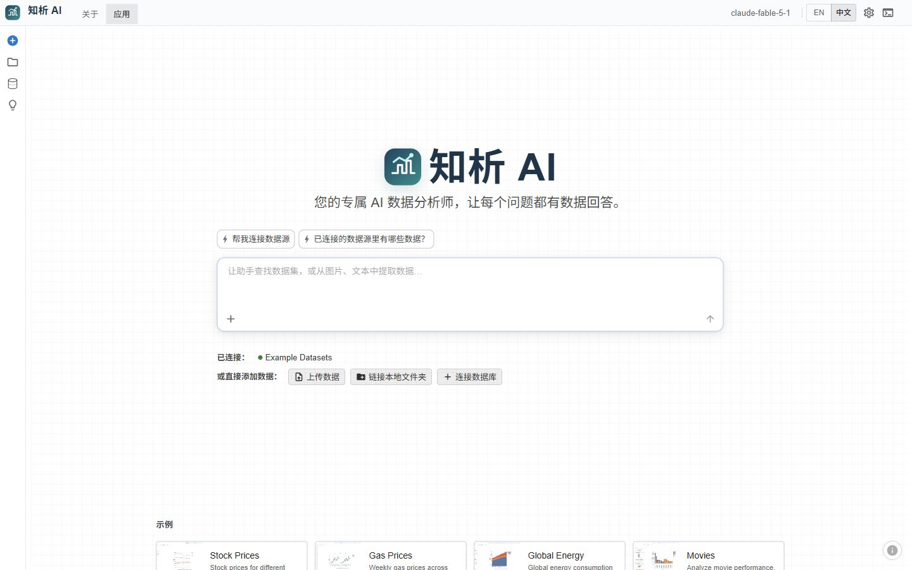
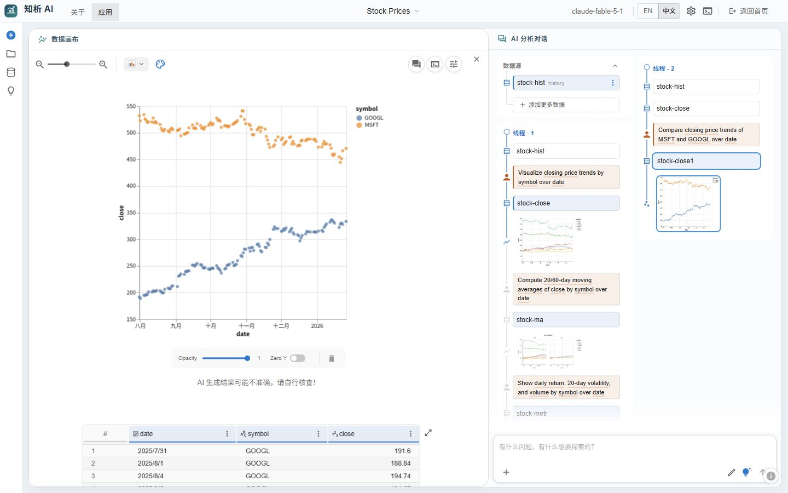

# 知析 AI

**从一个问题开始，把数据、分析过程和可视化留在同一个工作区。**

知析 AI 是一个可在本地运行的 AI 数据分析应用。打开首页，输入问题或选择示例数据；进入工作区后，左侧查看数据表与图表，右侧继续和分析助手对话。文件导入、数据连接、图表编辑、会话保存与报告等能力沿用原项目的数据分析流程。本仓库在此基础上调整了品牌和前端布局，并改善了模型流式回答中 `<think>` 标签的显示。

> 这是可运行的项目源码，不是只展示界面的静态页面。模型回答需要你自行配置兼容的 API，耗时取决于所用服务。

## 页面预览

### 1. 从首页提问

首页保留问题输入、数据导入、示例数据和历史会话。输入问题后进入分析工作区。



### 2. 在工作区分析

下图是在本地打开 **Stock Prices** 示例会话的实际运行画面：左侧是股票收盘价图表及数据表，右侧是数据源与分析过程。可继续提问、编辑图表，或返回首页重新打开已保存会话。



## 能做什么

| 环节 | 操作 |
| --- | --- |
| 接入数据 | 上传 CSV、TSV、JSON、Excel，使用示例数据，或按原项目支持的方式连接文件夹与数据库。 |
| 提问分析 | 用自然语言描述目标，查看助手的回答、数据处理结果和后续建议。 |
| 查看结果 | 在同一工作区检查数据表、图表、生成代码及分析线程。 |
| 继续工作 | 保存和重新打开会话，调整图表，并整理报告。 |

界面提供中文和英文切换。具体连接器的可用性取决于本地依赖、凭据及服务配置。

## 本地启动

**环境：** Python 3.11+、Node.js、Corepack（随常见 Node.js 安装提供）。建议在本机先用示例数据体验，再配置自己的模型与外部数据源。

### Windows PowerShell

```powershell
git clone https://github.com/Benjamindaoson/zhixiagent.git
cd zhixiagent

py -3.11 -m venv .venv
.\.venv\Scripts\python.exe -m pip install -e .

corepack yarn install --frozen-lockfile
npm run build

Copy-Item .env.example .env
# 编辑 .env：填入自己的模型地址、模型 ID 和密钥
.\.venv\Scripts\data_formulator.exe --port 5567 --disable-display-keys
```

### macOS / Linux

```bash
git clone https://github.com/Benjamindaoson/zhixiagent.git
cd zhixiagent

python3.11 -m venv .venv
./.venv/bin/python -m pip install -e .

corepack yarn install --frozen-lockfile
npm run build

cp .env.example .env
# 编辑 .env：填入自己的模型地址、模型 ID 和密钥
./.venv/bin/data_formulator --port 5567 --disable-display-keys
```

启动后访问 **<http://127.0.0.1:5567/>**。首次安装 Python 依赖需要下载较多包；前端构建也需要一些时间。若端口已占用，可在启动命令中修改 `--port`。

### 配置模型

项目根目录的 [`.env.example`](.env.example) 给出了 OpenAI 兼容接口的配置格式。复制为 `.env` 后，填写你自己的 `CLOUDCODE_API_KEY`、`CLOUDCODE_API_BASE` 和 `CLOUDCODE_MODELS`。`CLOUDCODE_ENDPOINT=openai` 表示按 OpenAI 兼容协议调用；实际模型 ID 和 API Base 请以服务商提供的值为准。

`.env` 已被 Git 忽略。**不要把密钥写进 README、截图、提交记录或公开 Issue。** 不配置模型时，仍可浏览界面与示例数据；AI 请求需要可用的模型服务。对外部模型发送数据前，请先确认所用服务符合你的数据使用要求。

## 体验路线

1. 在首页打开 **Stock Prices** 示例，查看已有数据和图表。
2. 在工作区选择图表，检查图表下方的数据表与右侧分析线程。
3. 在对话框输入一个基于示例数据的问题，例如“`stock-hist` 表有哪些字段？”
4. 点击右上角 **返回首页**，再从 **你的会话** 重新打开刚才的分析。

外部模型的响应速度会因网关与模型而变化。图表和 AI 生成的结论应结合原始数据核查。

## 开发与验证

前端使用 React、TypeScript、Vite 和 MUI；Python 服务负责提供页面与现有数据分析 API。前端构建产物位于 `py-src/data_formulator/dist/`，由 Python 服务加载。项目源码、测试与规范分别位于 `src/`、`py-src/data_formulator/`、`tests/` 和 `openspec/`。

```powershell
npx tsc --noEmit
npm test
npm run build
```

本地验证记录：TypeScript 检查通过；前端测试 **396/396** 通过；生产构建成功；在浏览器中验证了首页提问进入工作区、打开示例会话及返回首页。模型 API 的实际可用性仍取决于你的配置和服务状态。

## 许可与来源

本项目基于 [Microsoft Data Formulator](https://github.com/microsoft/data-formulator) 修改，遵循仓库中的 [MIT License](LICENSE)。原项目的版权和许可声明保留在源码及许可证文件中；本仓库的界面定制不代表与微软存在官方关联。
