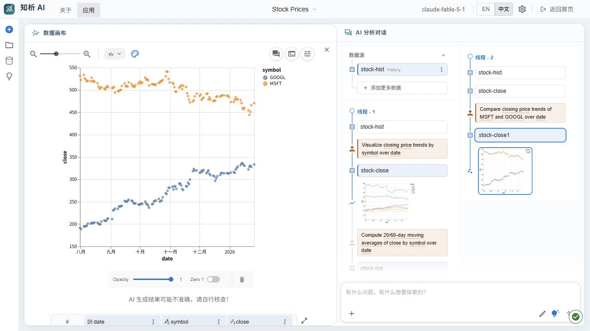
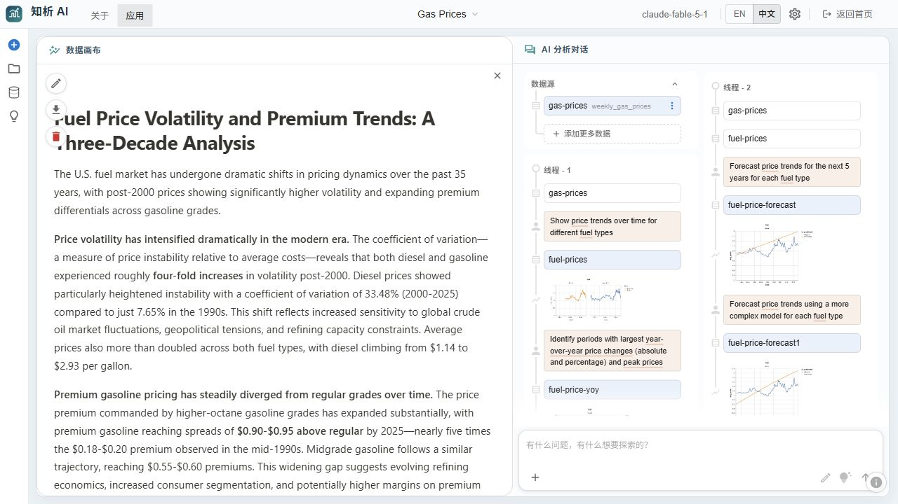
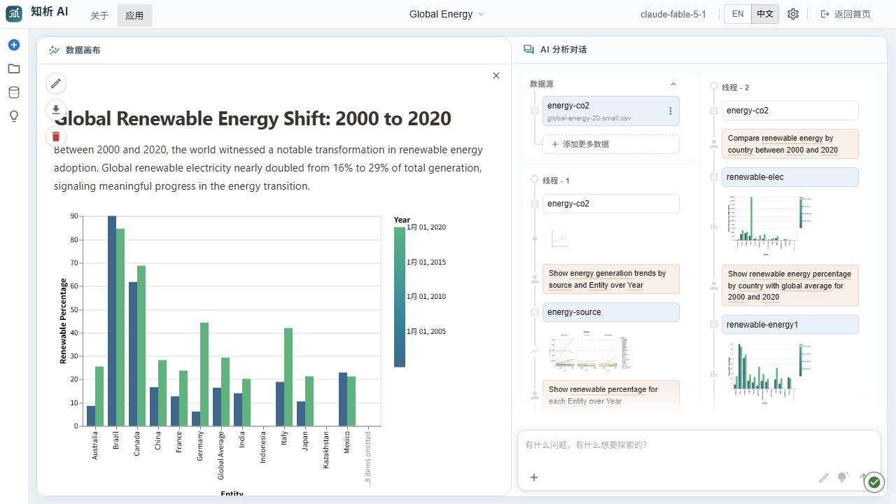
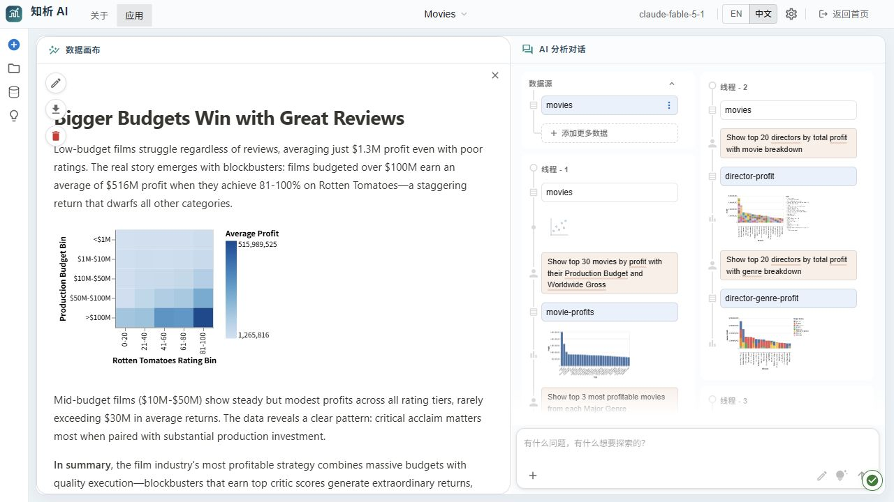
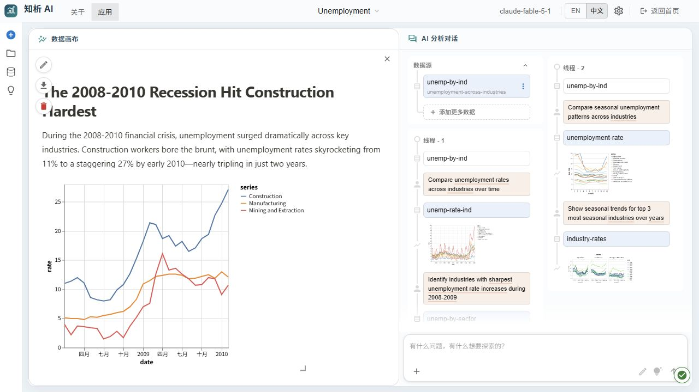
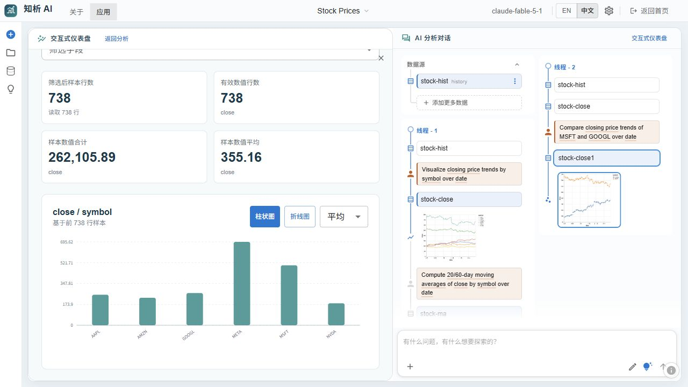
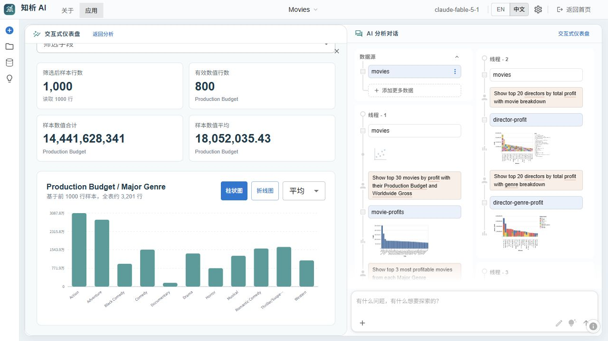
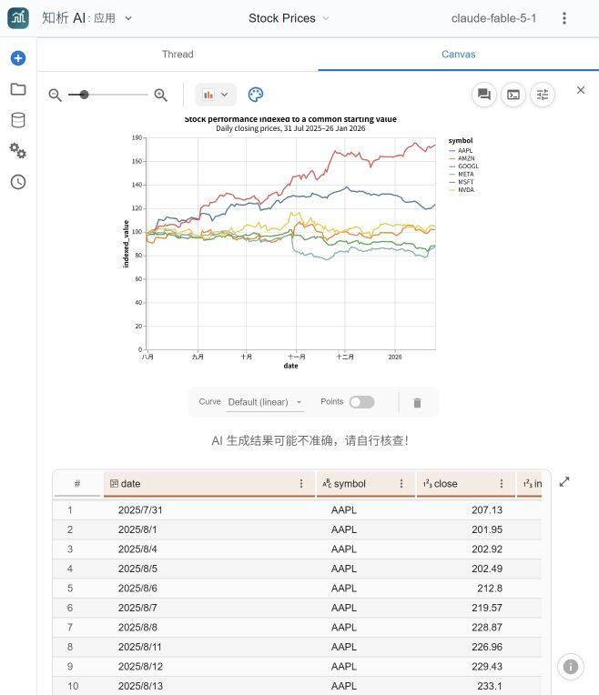

# 知析 AI｜可复用的智能数据分析工作台

**让数据分析不止于一次问答：把分析过程沉淀为可复用的方法，把计算结论落到可检查的证据。**

知析 AI 是一个面向探索式数据分析的开源应用：从自然语言问题出发，在同一工作区完成数据发现、计算、图表、报告和交互式分析应用，并将具有复用价值的分析过程整理为工作流。

项目重点探索三个问题：**如何复用分析方法、如何在任务变化时调整分析路径、如何避免未经核验的结论直接交付。**

> **运行边界**：这是可在本地运行的应用源码，不是静态界面。自然语言分析需要配置可用的模型接口；工作流执行、外部数据库连接等能力的实际效果取决于运行环境与授权。演示数据和示例报告不等同于真实业务验收。

## 一、核心设计

| 关注点 | 实现机制 | 解决的问题 |
| --- | --- | --- |
| 分析方法复用 | 抽象工作流 + 具体工作流 + 可变参数 | 避免每次重新描述相似的分析步骤 |
| 复杂任务执行 | 可检查的步骤计划、动态修订、失败回退 | 让分析任务能够持续推进，而非一次性生成答案 |
| 可信结果交付 | 执行证据、检查项、数据依赖及产物变化追踪 | 将“执行成功”和“分析结论可交付”区分开 |
| 业务语义理解 | 指标、维度、聚合规则、时间粒度与语义查询 | 避免把所有数据都当作可直接求和的原始字段 |
| 能力可扩展 | 按需加载的分析技能、工具门控、隔离执行 | 让分析能力可以组合，同时控制上下文和执行边界 |
| 结果可交互 | 数据画布、交互式仪表盘、报告和应用生成 | 让分析结果可追溯、可编辑、可继续探索 |

这些是当前代码中的架构机制，不代表所有行业数据已完成跨场景准确率验证，也不代表具备无条件的自主因果推断能力。

### 1. 将分析过程沉淀为可复用的方法

系统包含**工作流蒸馏**能力，可以从既有分析会话中提取分析目标、计算步骤、筛选与分组方式以及图表组织形式，并整理为两种层次：

- **抽象工作流**：保留指标趋势、分组对比、贡献分析等分析动作，去除具体数据集名称和字段名，便于迁移到其他数据集。
- **具体工作流**：保留原始字段、聚合方式、过滤条件和图表配置，便于在相似结构的数据上复现。
- **参数化入口**：将时间区间、地区、排序范围等可变条件提取为参数，而不是为每个新需求复制一份固定脚本。

这套机制旨在复用**分析路径**，而不只是复用某条查询语句。跨业务迁移仍需要匹配数据语义、字段及口径，并按实际数据验证结果。

关键实现：
- [工作流蒸馏](py-src/data_formulator/agents/agent_workflow_distill.py)
- [知识与工作流存储](py-src/data_formulator/knowledge/store.py)

### 2. 可调整计划，而不是固定的一条执行链

分析工作流不是“生成报告即完成”。任务执行过程维护步骤、检查项、证据和交付物；当数据检查发现问题或用户调整要求时，可以修订执行计划、重新评估先前步骤，并复用仍然有效的结果。

关键行为包括：

- 将业务问题组织为有明确输出和验收条件的分析步骤。
- 支持计划修订、步骤回访、失败修复与恢复执行。
- 将步骤访问、工具执行成功、检查通过、最终交付视为**不同状态**。
- 保留历史证据，避免任务恢复时无意义地重新读取和计算。

关键实现：
- [工作流执行智能体](py-src/data_formulator/workflows/agent.py)
- [工作流结构与参数约束](py-src/data_formulator/workflows/instances.py)
- [工作流设计规范](py-src/data_formulator/workflows/workflow-skill.md)

### 3. 用证据门禁约束分析交付

为减少“工具运行过，就默认结论正确”的问题，工作流通过计算结果与检查证据建立关联。系统追踪执行版本、工作区输入及生成产物的变化，对不再适用的证据重新检查；只有必要检查通过，才允许完成工作流交付。

这里的“可信”是**执行与证据层面的可核验**，并不意味着模型解释天然正确。相关性不能直接解释为因果性，样本统计也不能替代全量统计。

### 4. 从字段类型走向受约束的指标语义

系统可连接关系型数据库、文件和部分语义模型。对于 Cube、Power BI / Fabric 等语义数据源，优先使用它们已有的指标与维度定义，而不是直接把聚合后的数值再次求和。

- 读取指标、维度、时间粒度、聚合规则及相关元数据。
- 根据语义模型支持的方式构造查询，包含 Cube 查询及 DAX 查询。
- 区分数据目录中的**远程引用**与已实际加载、可供本地计算的数据。
- 大数据源可以先保留远程引用，再按需要选择字段、筛选条件或聚合范围，获得有界的计算输入。

关键实现：
- [Cube 语义连接器](py-src/data_formulator/data_loader/cube_data_loader.py)
- [Power BI 语义连接器](py-src/data_formulator/data_loader/powerbi_data_loader.py)
- [关联数据访问规范](py-src/data_formulator/analyst/skills/connected_data/SKILL.md)

### 5. 技能按需启用，计算与提交分离

系统以统一分析智能体为用户交互入口，通过技能注册机制按需启用数据访问、代码分析、图表、报告、交互式应用等能力：

- 技能文档与工具定义分离；需要时加载说明和可调用工具。
- 区分只读检查与会产生可见输出的提交动作，对提交实施门控。
- Python / DuckDB 用于数据检查、统计和计算；隔离执行降低生成代码的风险。
- 数据表、图表、报告与对话都保留在工作区，便于继续分析。

架构不是简单叠加多个聊天机器人；重点是**统一入口、分层技能、工作流执行与分析方法沉淀**。

关键实现：
- [分析智能体](py-src/data_formulator/analyst/agent.py)
- [技能注册与加载](py-src/data_formulator/analyst/skills/__init__.py)
- [分析技能](py-src/data_formulator/analyst/skills/analysis/SKILL.md)

## 二、界面与实际体验

### 自然语言进入分析工作区

从首页输入问题、导入数据或打开已有会话；进入工作区后，在数据表、图表、分析过程与对话之间持续切换。

### 示例数据与分析线程

以下截图来自本地运行的内置示例会话。图表与报告随示例加载，**不代表本次截图重新调用模型获得了这些结论**。

**股票价格：** 比较不同股票的价格走势。

**燃油价格：** 查看价格波动图表、示例报告和后续分析线程。

**全球能源：** 比较国家间可再生能源结构。

**电影数据：** 探索制作预算、评分与收益关系。

**行业失业率：** 对比不同行业的时间序列变化。

### 交互式仪表盘

在已加载的数据表上选择维度、数值字段和过滤条件，切换柱状图或折线图，并查看同步更新的指标卡。

**统计口径提示：** 当前轻量仪表盘基于最多 1,000 行已读取样本计算，其数值不应当作数据库全量指标。

### 从分析结果生成交互式应用

系统支持在工作区创建并预览 HTML / React 分析应用。下面是股票示例在本地测试中修正过滤条件后成功运行的交互界面。

### 图表文档导出

可以把图表的 Vega-Lite 配置、转换代码与已加载样本导出为可复用文档。导出内容保留采样范围信息，不声称代表完整数据集。

## 三、功能与验证状态

| 功能 | 当前情况 |
| --- | --- |
| 文件与示例数据 | 支持上传 CSV、TSV、JSON、Excel，或使用内置示例 |
| 交互式分析 | 支持自然语言提问、数据检查、代码计算、图表、报告与会话续接 |
| 分析方法沉淀 | 包含工作流蒸馏、知识规则、工作流存储及复用机制 |
| 工作流执行 | 包含计划、步骤检查、动态修订、失败恢复和交付验证逻辑 |
| 语义数据源 | 包含 Cube、Power BI / Fabric 等连接器；真实可用性依赖目标服务、凭据和权限 |
| 定时任务 | 包含本地调度能力；实际运行需保持服务及模型可用 |
| 交互式应用 | 已完成本地生成、修正与运行示例；不能据此断言所有生成代码无需修改 |
| 跨行业准确率 | 尚未公布统一的跨行业分析评测结果 |
| 归因与假设验证 | 可以借助现有分析工具与工作流探索，但尚未把通用自主归因引擎作为已验收能力 |

## 四、本地启动

要求：Python 3.11 或以上、Node.js、Corepack，以及用于自然语言分析的兼容模型服务。

**Windows（PowerShell）：**

~~~powershell
git clone https://github.com/Benjamindaoson/zhixiagent.git
cd zhixiagent

py -3.11 -m venv .venv
.\.venv\Scripts\python.exe -m pip install -e .

corepack yarn install --frozen-lockfile
npm run build

Copy-Item .env.example .env
# 在 .env 中配置模型服务
.\.venv\Scripts\data_formulator.exe --port 5567 --disable-display-keys
~~~

**macOS / Linux：**

~~~bash
git clone https://github.com/Benjamindaoson/zhixiagent.git
cd zhixiagent

python3.11 -m venv .venv
./.venv/bin/python -m pip install -e .

corepack yarn install --frozen-lockfile
npm run build

cp .env.example .env
# 在 .env 中配置模型服务
./.venv/bin/data_formulator --port 5567 --disable-display-keys
~~~

打开 **http://127.0.0.1:5567/**。

在 <code>.env</code> 中配置：
- <code>CLOUDCODE_ENDPOINT=openai</code>
- <code>CLOUDCODE_API_KEY</code>
- <code>CLOUDCODE_API_BASE</code>
- <code>CLOUDCODE_MODELS</code>

配置项示例见 [环境变量模板](.env.example)。模型接口配置由服务提供方决定。不要把真实密钥提交到 GitHub。部分云数据库连接器还需安装额外驱动或完成身份授权。

如果 Yarn 下载依赖失败，可尝试 <code>npm install --package-lock=false --legacy-peer-deps</code> 后重新构建。

## 五、体验建议

1. 从首页打开**股票价格**示例，在同一个工作区检查数据与图表。
2. 切换到**交互式仪表盘**，选取分组字段、数值字段和过滤条件，观察指标变化。
3. 返回分析画布，沿现有线程检查图表的数据依据和转换过程。
4. 配置模型后，围绕同一份数据继续提问，尝试生成新图表或分析应用。
5. 需要重复执行的任务，可进一步尝试工作流与知识管理相关功能。

## 六、项目工程与测试

后端以 Python 为主，前端采用 React、TypeScript、Vite 与 MUI；统计与表计算使用 Pandas、DuckDB 等工具。源码、测试与开发记录分别位于以下目录：

- <code>py-src/data_formulator/</code>：服务端、分析智能体、工作流、连接器及沙箱。
- <code>src/</code>：工作区、数据展示、可视化与交互界面。
- <code>tests/</code>：自动化测试。
- <code>openspec/</code>：设计与实现记录。
- <code>docs/</code>：集成、调试及测试证据。

仓库保存的**2026 年 10 月本地验证记录**包括：
- 后端：**2,763 项通过、174 项跳过、1 项意外通过**。
- 前端：**1,131 项通过、1 项待办**。
- TypeScript 类型检查和生产构建通过。
- 首页、示例会话、轻量仪表盘和交互应用进行了本地浏览器检查。

这些结果用于说明相应版本的本地工程质量，**不能替代生产环境的外部连接器、定时任务、模型推理质量或业务分析准确率验收**。详见 [验证记录](docs/verification/2026-10-16/README.md) 与 [更新说明](docs/updates/README.md)。

## 七、持续演进方向

- **分析能力内核**：为趋势、对比、结构拆解、贡献分析、假设检验等分析方法建立更明确的参数与输入输出约束。
- **语义与口径治理**：强化指标定义、实体映射、粒度兼容性与跨数据源一致性验证。
- **数据驱动的分析规划**：围绕业务问题形成候选假设、分析步骤、证据检查及下一轮探索的闭环。
- **跨场景评测**：建立覆盖不同数据结构、业务领域和任务难度的准确性、时延、成本与可解释性评测集。

以上为后续方向，**不视为当前已经完成的功能**。

## 许可与技术来源

本项目使用并延展了 [Microsoft Data Formulator](https://github.com/microsoft/data-formulator) 的 MIT 许可代码；原有版权与许可声明保留在 [LICENSE](LICENSE) 及相关源码中。知析 AI 的产品界面、整合改动、功能适配与验证记录由本仓库维护；相关技术来源和变更历史见 [版本集成记录](docs/upstream-integration.md)。本项目不代表微软官方产品。
