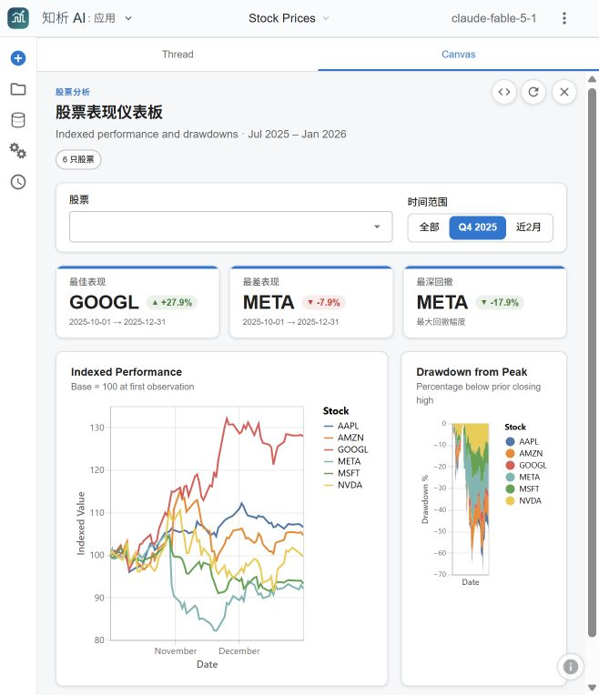

# 更新 04：交互应用实测与原地址恢复

本批不增加新的产品代码；记录用户可复核的运行结果和部署状态。前面三批的功能来源与测试见本目录对应更新说明。

## 实际操作

- 在隔离服务 `http://127.0.0.1:5568/` 打开 Stock Prices 示例，使用已配置的 OpenAI 兼容模型网关生成 React 股票表现仪表板。首次模型回答给出四个方向；选择股票和日期筛选方向后，模型生成了应用文件并在沙箱中显示指标卡与两张图。
- 首次选择 Q4 2025 时，生成文件使用了 `op: 'gte'`，数据查询层报出不支持的过滤操作符。仅修改该示例会话的生成文件，将日期条件改为 `op: 'range'` 与 `min`/`max`，重新加载后 Q4 指标和图表日期范围同步变化。此处是对一次模型生成内容的修正，不是对所有生成结果的正确性保证。
- 重新安装主目录项目独立 `.venv` 的 Python 依赖，更新前端依赖并运行生产构建；恢复原访问地址 `http://localhost:5567/`。主页 HTTP 200、品牌标题正确，`/api/data-loaders` HTTP 200 且列出 Azure SQL 与 Fabric。浏览器重新打开后确认首页、五个示例会话，以及工作流和定时任务入口。

## 验证命令与边界

`uv pip install --python .venv\Scripts\python.exe -e .`、`npm install --package-lock=false --ignore-scripts --legacy-peer-deps --registry=https://registry.npmjs.org --proxy=http://127.0.0.1:15236 --https-proxy=http://127.0.0.1:15236`、`npm run build`、`npx tsc --noEmit`、`npx vitest run --maxWorkers=2 --testTimeout=30000 --silent --reporter=dot`、`openspec validate upstream-branch-integration` 已执行成功。前端完整测试为 **1131 passed、1 todo**。代理地址只是本机安装时使用的临时入口；项目本身不依赖该地址。完整后端测试结果见[更新 01](2026-10-16-dev.md)。

生成应用的真实运行截图如下；沙箱应用文件存放在本地隔离服务的数据目录，不随源码仓库提交。外部 Azure 数据库连接、Chartifact 浏览器下载后的文件打开、定时任务实际触发仍未端到端验证。

